<div align="center">

# 🎬 VidSnapAI

**AI-assisted short-form video generation project**

[](https://python.org)
[](https://flask.palletsprojects.com/)
[](https://ffmpeg.org/)
[](https://elevenlabs.io/)
[](https://openai.com/research/whisper)
[](LICENSE.md)

[🌟 Live Demo](#-demo) • [✨ Features](#-features) • [🚀 Installation](#-installation)

</div>

---

## 💡 Product Overview

VidSnapAI is a Flask-based project that combines text-to-speech, subtitle generation, and FFmpeg video compositing to create short-form videos from user-supplied text and images. Performance, output quality, concurrency, and deployment readiness depend on the local environment and external AI services; these have not yet been benchmarked as production service guarantees.

---

## ✨ Features

### 🧠 AI Features
*   🎙️ **Text-to-Speech:** Voiceovers generated through the ElevenLabs API when a valid API key is configured.
*   🖋️ **Automatic Subtitles:** Subtitle timing generated through the project's Whisper pipeline.

### 🎬 Video Processing
*   🥁 **Beat-Sync Processing:** Music-beat analysis can inform image durations in the video pipeline.
*   🔊 **Audio Mixing:** Background music and narration are combined by the video processing pipeline; verify results with your own sample files.
*   🎞️ **FFmpeg Compositing:** Programmatic video assembly with the transition options implemented in the project.

### 🎨 UI/UX
*   ✨ **Web Interface:** Browser-based upload, generation, and gallery pages.
*   🌓 **Theme Controls:** Light/dark theme styling is included in the frontend.

---

## 📺 Demo

| Home Dashboard | Video Generation | Image Gallery |
| :---: | :---: | :---: |
|  |  |  |
| **Workspace Overview** | **Automated Pipeline** | **Content Management** |

---

## 🔄 Website Workflow

1. **Upload & Prompt:** Provide a topic/text prompt, and drop your base images into the intuitive creator dashboard.
2. **AI Generation & Processing:** The engine automatically synthesizes neural speech, calculates Whisper subtitle timings, and maps beat-synced transitions.
3. **Video Compositing:** Watch as FFmpeg seamlessly multiplexes voice, music, generated subtitles, and visual effects in the background.
4. **Export & Share:** Preview and download the generated MP4 from the integrated Gallery.

---

## 🏗️ Architecture

<p align="center">
  
</p>

1. **Ingestion:** Frontend sends generation requests and media to the Flask API.
2. **Text-to-Speech:** Text payload is synthesized into neural speech via API.
3. **Transcription:** Audio is processed for accurate, word-synced subtitles.
4. **Beat-Sync:** Background music is analyzed for optimal visual transition points.
5. **Compositing:** Voice, music, media, and subtitles are multiplexed into an `.mp4` file.

---

## 🛠️ Tech Stack

| Tool | Purpose |
| :--- | :--- |
| **Flask** | Backend API & Orchestration |
| **FFmpeg** | Video compositing & processing |
| **Whisper** | AI Subtitle Generation |
| **ElevenLabs** | Neural Text-to-Speech |

---


## ☁️ Vercel deployment

The Flask web interface has a Vercel Python Function entry point. Follow [`VERCEL_DEPLOYMENT.md`](VERCEL_DEPLOYMENT.md) for environment variables and setup. **Video generation and audio preview are intentionally disabled on Vercel serverless** because FFmpeg/Whisper workloads, uploads, and generated files need a persistent worker and durable storage. Use a separate worker service for full generation.

## 🔐 Security Notes

- Never commit `.env` files or API credentials. Use `.env.example` as a blank template and set `ELEVENLABS_API_KEY` locally or in the deployment secret store.
- If a key was ever committed, revoke/rotate it with the provider immediately. Removing the file in a later commit does not remove it from Git history; rewrite history if needed and coordinate the force-push carefully.
- The development server is bound to `127.0.0.1` by default. Do not expose Flask's built-in server to the public internet.
- Upload checks include extension and basic file-content validation, plus request and field limits. They are not a substitute for sandboxed media decoding, malware scanning, authentication/authorization, CSRF protection, per-user quotas, and resource limits.
- Generation still has synchronous work in the web request path. Use a durable queue/worker design before accepting untrusted public traffic.

## 🚧 Production-readiness status

This repository is an active project, not a certified or audited production service. Authentication and authorization, CSRF protections, durable background jobs, concurrency/load testing, secure media sandboxing, monitoring, and deployment-specific hardening still require implementation and verification. Do not use it to process sensitive uploads or expose it publicly without completing those controls.

## 🧪 Validation

Run a syntax check before launching:

```bash
python -m compileall -q main.py generate_process.py text_to_audio.py config.py pipeline security_utils.py
python -m unittest discover -v
```

A full end-to-end test requires FFmpeg, the Whisper dependencies/model, and a valid ElevenLabs API key. CI compile/unit checks do not verify external AI providers, long-running render jobs, concurrent workloads, or production deployment.

## 📁 Project Structure

```bash
VidSnapAI/
├── main.py                 # Application entry point
├── generate_process.py     # Background worker logic
├── text_to_audio.py        # Speech generation interface
├── config.py               # Environment configuration
├── pipeline/               # Core AI editing engine modules
├── static/                 # Frontend assets (CSS, JS, Media)
└── templates/              # Jinja2 HTML templates
```

---

## 🚀 Installation

### Prerequisites
*   Python 3.8+
*   FFmpeg explicitly installed and added to PATH
*   ElevenLabs API Key

### Setup
```bash
# 1. Clone the repository
git clone https://github.com/Piyu242005/VidSnapAI-Piyu24.git
cd VidSnapAI-Piyu24

# 2. Setup virtual environment
python -m venv .venv
source .venv/bin/activate  # Or .\venv\Scripts\activate on Windows

# 3. Install dependencies
pip install -r requirements.txt

# 3b. Create local environment config (fill in your own API key; never commit it)
# Copy .env.example to .env, then edit .env

# 4. Run application (Requires 2 terminals)
# Terminal 1:
python main.py
# Terminal 2:
python generate_process.py
```

---

## 👨‍💻 Author

**Piyush Ramteke**
Data Scientist | AI Developer

[GitHub Profile](https://github.com/Piyu242005)